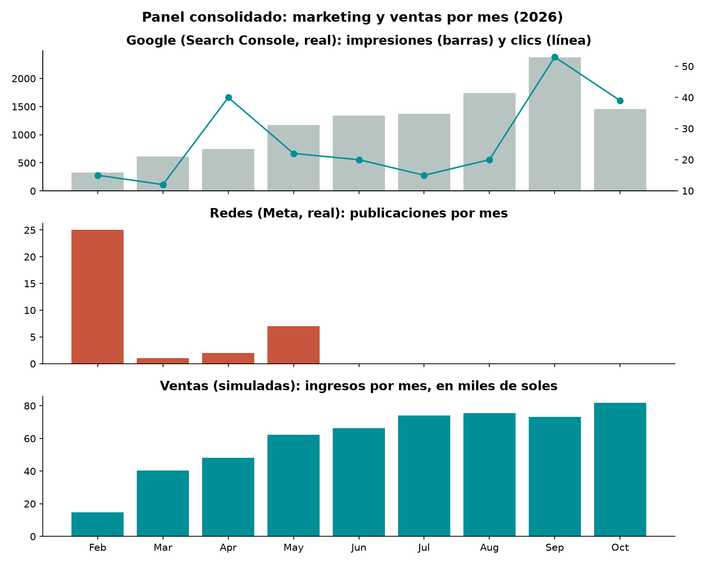
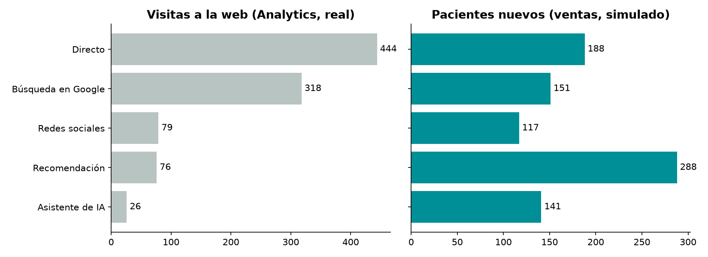
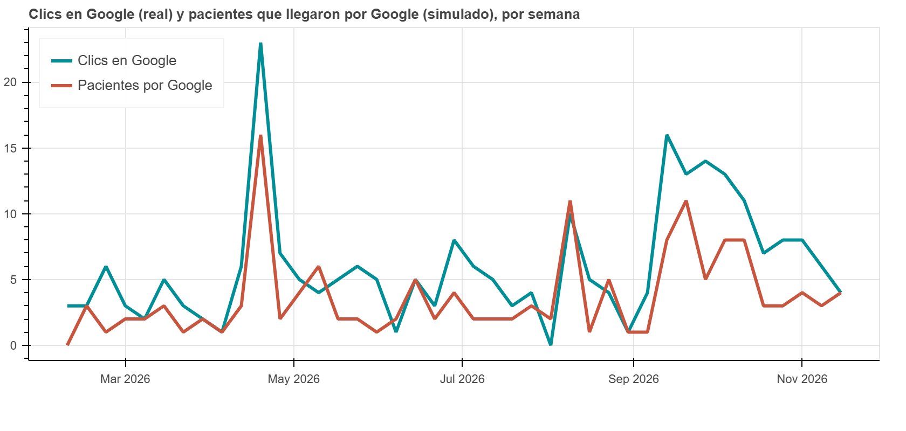
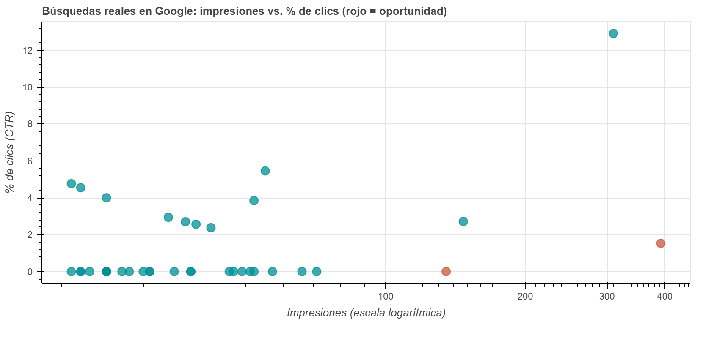

# Consolidación y visualización de datos de marketing y ventas de un centro de psicología online

**Trabajo final — Herramientas para Inteligencia Artificial**
Maestría en Inteligencia Artificial Aplicada (UCSM–UTPL) · Alejandro Adriazola

**Contenido**
1. [Introducción](#1-introducción)
2. [Marco teórico](#2-marco-teórico)
3. [Descripción del dataset](#3-descripción-del-dataset)
4. [Pasos realizados](#4-pasos-realizados)
5. [Conclusiones](#5-conclusiones)
6. [Bibliografía](#6-bibliografía)

---

## 1. Introducción

Un centro de psicología online capta pacientes por varios canales: búsquedas en Google, su sitio web, sus redes sociales y recomendaciones. Cada canal se mide en una plataforma distinta:
- Google Search Console registra las búsquedas;
- Google Analytics registra las visitas a la web;
- Meta Business Suite registra las publicaciones en Facebook e Instagram;
- un registro aparte guarda las ventas.

Cada plataforma muestra solo una parte. **Sin una vista consolidada**, no se puede ver cómo evoluciona el marketing junto con las ventas ni comparar los canales entre sí.

**Objetivo general:** integrar las fuentes de marketing y de ventas en un solo dataset y construir visualizaciones informativas que permitan interpretarlo.

**Objetivos específicos:**
1. Cargar un dataset desde archivos CSV y otro desde una base de datos SQLite con Pandas.
2. Limpiar y estandarizar los datos de cada fuente.
3. Unir las fuentes por fecha y por canal.
4. Visualizar el resultado con Matplotlib, Bokeh y PyGWalker, e interpretarlo.

## 2. Marco teórico

| Tecnología | Qué es | Uso en el trabajo |
|---|---|---|
| **Python** | Lenguaje de programación de propósito general, el más usado en ciencia de datos. | Todo el proyecto. |
| **JupyterLab** | Entorno web que combina código, resultados y texto en un *notebook* (Kluyver et al., 2016). | Documentar y ejecutar cada paso. |
| **Pandas** | Librería para manipular datos tabulares en estructuras llamadas *DataFrames* (McKinney, 2010, 2022). | Leer los CSV y la base de datos, limpiar, unir (`merge`) y agregar. |
| **NumPy** | Librería de cálculo numérico con arreglos (Harris et al., 2020). | Generar las ventas sintéticas. |
| **SQLite** | Motor de base de datos relacional en un solo archivo, sin servidor (SQLite, s. f.). | Almacenar las tablas `canales`, `pacientes` y `sesiones`. |
| **SQL** | Lenguaje estándar para definir, insertar y consultar datos relacionales. | Scripts de creación, inserción y consultas con `JOIN`. |
| **Matplotlib** | Librería de gráficos estáticos de Python (Hunter, 2007). | Panel mensual y comparación por canal. |
| **Bokeh** | Librería de visualizaciones **interactivas** para el navegador (Bokeh Development Team, 2025). | Evolución semanal y análisis de búsquedas con información al pasar el mouse. |
| **PyGWalker** | Convierte un DataFrame en una interfaz de exploración visual tipo Tableau (Kanaries, 2025). | Exploración libre del dataset consolidado. |
| **Git y GitHub** | Control de versiones y plataforma para publicar repositorios. | Publicar el código, los datos y este informe. |

**Integración de datos.** Consiste en combinar datos de fuentes distintas en una vista unificada. Para lograrlo hay que resolver diferencias de formato, de nombres y de granularidad entre las fuentes (Doan et al., 2012).

**Datos sintéticos.** Son datos generados por un programa que imitan la estructura de datos reales sin corresponder a personas reales. Se usan cuando los datos originales son sensibles (Jordon et al., 2022), como los registros de pacientes de un servicio de salud mental.

## 3. Descripción del dataset

### 3.1 Dataset 1 — Marketing digital (CSV, datos reales)

Son cinco exports descargados directamente de cada plataforma, sin modificar. Son datos **agregados**: conteos de clics, visitas y publicaciones, sin información de personas. Suman **795 filas** y cubren 2026.

| Archivo | Plataforma | Filas | Columnas principales |
|---|---|---|---|
| `gsc_rendimiento_diario.csv` | Google Search Console | 284 | Fecha, Clics, Impresiones, CTR, Posición |
| `gsc_consultas.csv` | Google Search Console | 467 | Consulta, Clics, Impresiones, CTR, Posición |
| `ga4_canales.csv` | Google Analytics 4 | 6 | Canal, Sesiones, Interacción, Eventos |
| `meta_facebook.csv` | Meta Business Suite | 18 | Fecha de publicación, Tipo, Espectadores, Reacciones |
| `meta_instagram.csv` | Meta Business Suite | 20 | Fecha de publicación, Tipo, Alcance, Me gusta |

### 3.2 Dataset 2 — Ventas (base de datos SQLite, datos sintéticos)

Archivo: `datos/ventas.db`. Se crea con `sql/01_crear_tablas.sql` y se llena con `sql/02_insertar_datos.sql`. Ambos scripts los genera `generar_datos.py`.

| Tabla | Filas | Columnas |
|---|---|---|
| `canales` | 6 | `id_canal`, `nombre`, `tipo` |
| `pacientes` | 885 | `id_paciente`, `id_canal` (FK → canales), `fecha_primera_sesion`, `plan`, `tipo_terapia` |
| `sesiones` | 5 493 | `id_sesion`, `id_paciente` (FK → pacientes), `fecha`, `monto` |

**Por qué son sintéticos.** Las ventas reales contienen datos de pacientes de un servicio de salud mental, que no pueden publicarse.

**Cómo se generaron.** El script simula un escenario del 03-feb al 13-nov de 2026, el mismo periodo de Search Console:
- Los pacientes que llegan por Google siguen el ritmo de los **clics reales** de cada día.
- Los que llegan por Instagram o Facebook aumentan los días posteriores a una **publicación real**.
- Los demás canales llegan con un ritmo constante.
- Cada paciente compra un plan (consulta suelta, paquete de 4 u 8 sesiones o terapia continua) y asiste a sesiones semanales.

El escenario está escalado para alcanzar un volumen de datos suficiente: incluye pacientes que contactan sin pasar por la web, por WhatsApp o por recomendación.

**Volumen total:** 795 filas reales + 6 384 registros de ventas = **7 179 registros**.

### 3.3 Cómo se unen

```
CSV marketing (por día) ──(fecha)──> sesiones / pacientes ──(id_canal)──> canales
CSV Analytics (por canal) ──(grupo de canal)──────────────────────────────┘
```

### 3.4 Dataset final

- `datos/final/consolidado_diario.csv`: **284 filas × 10 columnas**. Una fila por día, con clics, impresiones, CTR y posición en Google, publicaciones y alcance en redes, pacientes nuevos, sesiones e ingresos.
- `datos/final/consolidado_por_canal.csv`: **5 filas**. Visitas a la web (Analytics), pacientes, ingresos y ticket promedio por canal.

## 4. Pasos realizados

1. **Entorno.** Entorno virtual de Python con las librerías de `requirements.txt`, y JupyterLab.
2. **Base de datos.** `generar_datos.py` escribe y ejecuta los scripts SQL que crean `ventas.db`.
3. **Carga.** Los CSV se leen con `pd.read_csv`; en el caso de Analytics se usa `comment="#"` para saltar sus líneas de comentario. La base se lee con `sqlite3.connect` y `pd.read_sql`.
4. **Limpieza:**
   - **Search Console:** el CTR pasa de texto con `%` a número y la fecha a tipo fecha.
   - **Consultas:** se quitan las tildes y se suman las búsquedas que solo se diferenciaban por la tilde (de 467 a 420).
   - **Analytics:** los canales en inglés se traducen a los mismos grupos que usa la base de ventas y se descarta *Unassigned*.
   - **Meta:** Facebook (30 columnas) e Instagram (18 columnas) se estandarizan a 5 columnas comunes, y la fecha en formato mes/día/año se convierte a tipo fecha.
5. **Unión** con `pd.merge`:
   - **Tabla diaria:** se parte de un calendario completo y se le une, con *left join*, el rendimiento de Google, las publicaciones, los pacientes nuevos y las sesiones.
   - **Tabla por canal:** se unen las visitas de Analytics con los pacientes e ingresos de la base de ventas.
6. **Consultas SQL** (`sql/03_consultas.sql`): ingresos por canal, ingresos por plan e ingresos por mes, con `JOIN` entre las tres tablas.
7. **Visualizaciones** (ver 4.1).
8. **Exportación** del dataset final a CSV.
9. **Publicación** en GitHub: código, datos, README y esta wiki.

### 4.1 Visualizaciones

**Visualización 1 — Matplotlib: panel mensual consolidado**



Reúne en un solo gráfico las tres fuentes mes a mes:
- **Google (real):** las impresiones crecen de forma sostenida, de 328 en febrero a un pico de 2 376 en septiembre, mientras los clics se mantienen bajos.
- **Redes (real):** la actividad se concentra en febrero (25 publicaciones) y desaparece desde junio.
- **Ventas (simuladas):** los ingresos crecen mes a mes.

**Visualización 2 — Matplotlib: visitas a la web y pacientes por canal**



Compara las visitas reales a la web por canal (Analytics) con los pacientes de la base de ventas:
- "Directo" y "Búsqueda en Google" concentran las visitas a la web.
- En el escenario simulado, "Recomendación" aporta más pacientes sin pasar casi por la web.

La comparación muestra por qué las visitas no bastan para evaluar un canal.

**Visualización 3 — Bokeh: evolución semanal (interactivo)**



Muestra semana a semana los clics reales en Google y los pacientes simulados que llegaron por Google. Al pasar el mouse se ven los valores de cada semana. Las dos curvas se mueven juntas (correlación de 0,83), algo esperado porque la simulación usa los clics reales. En un caso real, este gráfico serviría para comprobar si las semanas con más tráfico generan más pacientes.

**Visualización 4 — Bokeh: búsquedas en Google (interactivo)**



Cada punto es una búsqueda real. Los puntos en rojo tienen 100 o más impresiones y menos de 2 % de clics. Son oportunidades de mejora, por ejemplo "psicologo deportivo", con 392 impresiones.

**Visualización 5 — PyGWalker: explorador del dataset consolidado**

Interfaz tipo Tableau dentro del notebook sobre el dataset diario. Permite armar cruces sin programar, arrastrando columnas.

## 5. Conclusiones

1. **La integración es posible con herramientas abiertas.** Pandas permitió unir fuentes con formatos muy distintos (exports con comentarios, porcentajes en texto, fechas en distintos formatos, columnas diferentes entre Facebook e Instagram) con una base SQLite, y obtener un dataset diario de 284 filas.
2. **La vista consolidada muestra lo que cada plataforma esconde.** En los datos reales, la visibilidad en Google se multiplicó por siete entre febrero y septiembre, pero los clics no crecieron al mismo ritmo, y la actividad en redes se detuvo desde junio. Ninguna plataforma por separado muestra las dos cosas a la vez.
3. **Las visitas no equivalen a pacientes.** La comparación por canal muestra que un canal con pocas visitas puede aportar muchos pacientes. Para evaluar el marketing hay que unir los datos de marketing con los de ventas.
4. **Cada librería cumplió un rol distinto:** Matplotlib para el informe, Bokeh para explorar el detalle e PyGWalker para cruces libres sin código.

**Limitaciones.** Las ventas son simuladas, y las relaciones entre marketing y ventas que se observan se deben en parte a cómo se generaron. Los exports de Meta solo cubren las publicaciones disponibles para descarga. Con datos reales de ventas, el mismo notebook permitiría conclusiones válidas para el negocio.

**Trabajo futuro:**
- Conectar las fuentes de forma automática mediante las APIs de Search Console, Analytics y Meta.
- Actualizar el panel periódicamente.
- Con datos reales suficientes, estimar el aporte de cada canal a las ventas.

## 6. Bibliografía

- Bokeh Development Team. (2025). *Bokeh: Python library for interactive visualization* (versión 3.10) [Software]. https://bokeh.org
- Doan, A., Halevy, A., & Ives, Z. (2012). *Principles of data integration*. Morgan Kaufmann.
- Harris, C. R., Millman, K. J., van der Walt, S. J., et al. (2020). Array programming with NumPy. *Nature, 585*, 357–362. https://doi.org/10.1038/s41586-020-2649-2
- Hunter, J. D. (2007). Matplotlib: A 2D graphics environment. *Computing in Science & Engineering, 9*(3), 90–95. https://doi.org/10.1109/MCSE.2007.55
- Jordon, J., Szpruch, L., Houssiau, F., et al. (2022). *Synthetic data: What, why and how?* arXiv. https://arxiv.org/abs/2205.03257
- Kanaries. (2025). *PyGWalker: Turn your pandas dataframe into a Tableau-style user interface* [Software]. https://github.com/Kanaries/pygwalker
- Kluyver, T., Ragan-Kelley, B., Pérez, F., et al. (2016). Jupyter Notebooks: A publishing format for reproducible computational workflows. En *Positioning and Power in Academic Publishing* (pp. 87–90). IOS Press. https://doi.org/10.3233/978-1-61499-649-1-87
- McKinney, W. (2010). Data structures for statistical computing in Python. En *Proceedings of the 9th Python in Science Conference* (pp. 56–61). https://doi.org/10.25080/Majora-92bf1922-00a
- McKinney, W. (2022). *Python for data analysis* (3.ª ed.). O'Reilly Media. https://wesmckinney.com/book/
- SQLite. (s. f.). *About SQLite*. Recuperado el 25 de noviembre de 2026 de https://www.sqlite.org/about.html
